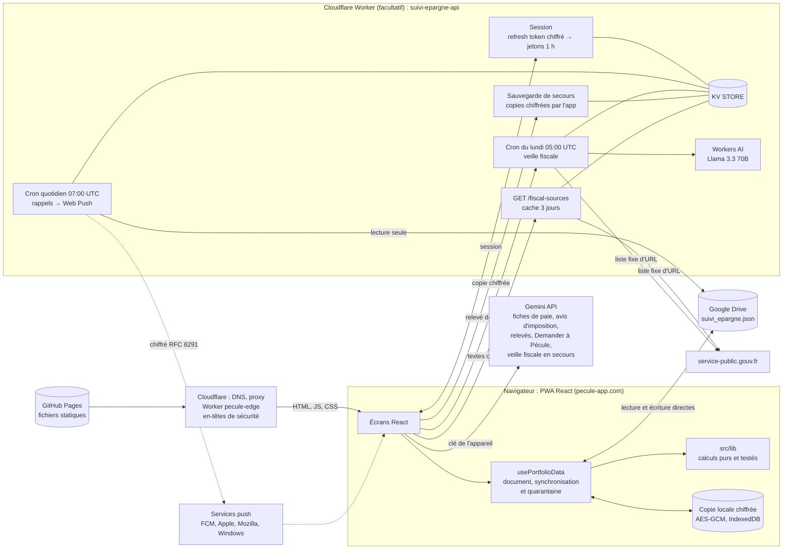

<div align="center">


# Pécule

**Faites pousser votre épargne.**

Tableau de bord d'épargne personnel, calibré pour la fiscalité française.
Sans base de données : vos données restent dans **un seul fichier, sur votre propre Google Drive**.

[](https://github.com/antoninnourisson-cloud/suivi-epargne/actions/workflows/ci.yml)
[](https://github.com/antoninnourisson-cloud/suivi-epargne/actions/workflows/deploy.yml)
[](https://github.com/antoninnourisson-cloud/suivi-epargne/actions/workflows/monitor.yml)
[](LICENSE)
[](https://pecule-app.com/)

[](https://react.dev/)
[](https://www.typescriptlang.org/)
[](https://vite.dev/)
[](https://tailwindcss.com/)
[](https://recharts.org/)
[](https://vitest.dev/)
[](https://playwright.dev/)
[](https://m3.material.io/)
[](.nvmrc)
[](worker/)

[**Ouvrir l'app**](https://pecule-app.com/) ·
[Confidentialité](https://pecule-app.com/confidentialite.html) ·
[Nouveautés](https://github.com/antoninnourisson-cloud/suivi-epargne/releases) ·
[Maintenance](MAINTENANCE.md) ·
[Feuille de route](ROADMAP.md) ·
[Wiki](https://github.com/antoninnourisson-cloud/suivi-epargne/wiki) ·
[Contact](mailto:contact@pecule-app.com)


</div>

---

## Sommaire

- [Présentation](#présentation)
- [Fonctionnalités](#fonctionnalités)
- [Architecture](#architecture)
- [Modèle de données et invariants](#modèle-de-données-et-invariants)
- [Sécurité et confidentialité](#sécurité-et-confidentialité)
- [Démarrage rapide](#démarrage-rapide)
- [Déploiement](#déploiement)
- [Structure du projet](#structure-du-projet)
- [Installer l'app sur mobile](#installer-lapp-sur-mobile)
- [Contribuer](#contribuer)
- [Licence](#licence)
- [Crédits](#crédits)

## Présentation

Pécule (anciennement *Suivi Épargne*) est une application web installable (PWA) pour suivre ses comptes d'épargne, piloter sa paie mois après mois et anticiper sa fiscalité : livrets réglementés, PEA, assurance vie, PEE, PER, crypto.

- **Pas de base de données.** Tout tient dans `suivi_epargne.json`, sur le Google Drive de l'utilisateur. L'app ne voit que les fichiers qu'elle a créés (portée OAuth `drive.file`).
- **Un serveur facultatif.** Un petit Cloudflare Worker ([`worker/`](worker/)) apporte ce qu'un navigateur seul ne peut pas faire : une session Google persistante, des notifications push quotidiennes, la veille fiscale hebdomadaire (pages officielles lues par Cloudflare Workers AI) et une sauvegarde de secours chiffrée par l'app, qu'il ne peut pas lire. Sans lui, l'app fonctionne entièrement dans le navigateur.
- **Rien n'est appliqué sans vous.** Échéances récurrentes, propositions de la veille fiscale, données extraites d'une fiche de paie : tout est proposé, puis validé par l'utilisateur.

## Fonctionnalités

### Tableau de bord
- **Épargne nette** répartie entre *disponible*, *contrainte fiscale* (AV/PEA récents : impôt en plus d'un retrait anticipé, date où il devient gratuit) et *bloqué* (PER, PEE : chaque versement de PEE se débloque 5 ans après sa date).
- **Un chiffre principal** : épargne nette, variation sur 30 jours et courbe sur un an ; les détails moins utiles sont repliés.
- **À faire** : les trois actions les plus importantes, avec « Plus tard », **chiffrées en euros** quand c'est possible (argent qui dort sur le compte courant, compte mieux rémunéré qui a de la place, livret bientôt plein). Plafonds des livrets, révision des taux réglementés (1er février et 1er août), éligibilité au LEP, soldes non actualisés, comptes vides inactifs, intérêts parentaux de fin d'année.
- **Épargne du mois d'épargne** (« Épargne de novembre » : jauge face au plan, de la paie reçue à la suivante), **taux d'épargne** sur douze mois, **épargne de précaution**.
- **Projection** à 6 et 12 mois d'après le rythme réel des 90 derniers jours, avec une alerte si le rythme dérive.
- Prélèvements des 7 prochains jours, évolution empilée par compte, répartition par établissement.
- Pastille sur l'icône de l'app installée : nombre de choses à faire.
- **Demander à Pécule** (Accueil, feuille « Plus » sur téléphone, menu latéral sur ordinateur) : questions en français sur ses propres chiffres (« Combien ai-je épargné ce trimestre ? »), suggestions, conversation à plusieurs tours. Gemini répond avec la clé de l'appareil (calculs confiés à son exécution de code, réinterrogé sans si le modèle la refuse) d'après un résumé compact et déterministe des données (`src/lib/askSnapshot.ts` : comptes, épargne sur 24 mois et totaux déjà calculés, soldes mensuels, 60 jours à venir, virements, abonnements, paie nette, intérêts, impôt, restitution ; ni e-mail, ni identifiant Drive, ni clé, ni texte libre ; taille plafonnée). Lecture seule ; conversation en mémoire seulement, effacée à la fermeture et à la déconnexion (le verrouillage la garde en mémoire, derrière le verrou).

### Comptes et mouvements
- **Part propre et capital des parents** distingués sur chaque compte. Le capital parental est intouchable, ses intérêts reviennent à l'utilisateur.
- **Actualiser solde** : nouveau solde, total affiché par la banque, ou ajustement « + / − x € ».
- **Tous les types de compte** : livrets réglementés, livret bancaire, CEL et PEL (régime fiscal selon la date d'ouverture), compte à terme, compte courant, PEA, compte-titres, assurance vie, PER, PEE, crypto, immobilier, « Autre » (disponible, ou marqué bloqué).
- **Versements cumulés** (PEA, compte-titres, assurance vie, crypto…) : un versement se distingue d'une variation de valeur. **Performance** de chaque placement : gain et rendement annuel pondéré par les dates (TRI).
- **Fraîcheur des soldes** compte par compte (« vérifié il y a 41 jours ») : le rappel nomme les comptes à revérifier ; un versement prévu ne compte pas comme un solde vérifié. Dans Actualiser, « Inchangé » confirme un solde tel quel (constat daté, aucun mouvement, annulable) ; ailleurs, le bouton s'appelle « Confirmer le solde ».
- **Mode discret** : bouton œil (en-tête et menu latéral) ou Paramètres › Affichage ; tous les montants formatés deviennent « •••• € » (réglage de l'appareil, coupé par défaut). Confort d'affichage seulement : pourcentages et courbes restent visibles, les données et ce qui part vers Drive ou Gemini ne changent pas.
- **Routine du mois** (Accueil) : « Routine de novembre », trois étapes déduites des données (paie reçue et répartie : déclaration, virements et bilan, qui ouvre le rituel ; fiche de paie du mois ; soldes actualisés), repliée en une ligne une fois faite (`src/lib/monthRoutine.ts`).
- **Étiquettes** libres (un projet : voyage, apport…), avec le total par étiquette.
- **Navigation** (`src/navigation.ts`) : 7 écrans (Accueil, Actualiser, Comptes, Pilotage, Analyses, Impôts, Paramètres). Barre du bas : Accueil, Actualiser, Comptes, Pilotage, Plus ; « Plus » : Demander à Pécule, Analyses, Impôts, Paramètres ; menu latéral : Ajouter un mouvement, Demander à Pécule, six écrans, Paramètres, Déconnexion. Onglets : Comptes (Soldes, Mouvements, Parents ; Parents masqué en mode solo), Pilotage (Ce mois, Abonnements, Fiches de paie, Envies), Analyses (Évolution, Rendement, Agenda, Et si…), Impôts (Dons et déclaration, Calendrier fiscal). Chaque ancienne adresse (`?view=`) est un alias qui ouvre son onglet ; l'onglet mémorisé ne sert qu'aux gestes de menu. **Geste Retour** du téléphone (`src/app/backHistory.ts`) : il ferme la fenêtre ou la feuille ouverte, puis revient à l'écran précédent, au lieu de quitter l'app.
- **Journal des modifications** (Comptes › Mouvements) : mouvements, taux, restitution. Annulation, mouvements de test qui s'annulent repérés, marquage « Pas de l'épargne », « Repartir de zéro » à une date sans rien effacer.
- **Recherche** dans tous les mouvements, étiquettes, virements internes liés, mouvements récurrents mensuels.
- **Ajout rapide** : bouton flottant « Mouvement » (choix Dépôt, Retrait, Virement, Envie ; vos trois derniers libellés du compte sont proposés en premier) et raccourcis de l'icône installée (ajouter un mouvement ou une envie, actualiser, paie reçue).
- **Virements** : le virement entre vos comptes (annulable, refusé au-delà de votre part) se fait dans le bouton « Mouvement », choix Virement ; « Faire un virement » (Comptes › Mouvements) ouvre la même feuille, et les mouvements récurrents sont dans le même onglet.
- **Taux des livrets datés** (date d'effet), mis à jour pour tous les livrets concernés d'un coup. **Conseil quinzaine** avant un retrait de livret.
- **« J'ai besoin d'argent : où le prendre ? »** (bouton « Mouvement » et Comptes › Mouvements, `src/lib/needMoney.ts`) : montant et jour du besoin, puis le moins cher d'abord (livrets du plus petit taux au plus grand, LEP en dernier, puis assurance vie, puis PEA de plus de 5 ans), sur votre part seulement ; coût de chaque ligne en intérêts perdus et en impôt, meilleur jour pour un livret, effet sur l'épargne de précaution. Le retrait peut être enregistré ou seulement prévu (un retrait prévu est rappelé sur l'Accueil).

### Paie et budget
- **Envies d'achats** (Pilotage › Envies, `src/lib/wishes.ts`) : un achat envisagé avec son prix et la date du prix (« à revérifier » après 3 mois, aucun relevé automatique sur les sites), un lien et une catégorie modifiable (Maison, Livres, Gros projets, Loisirs, Tech…). Totaux par catégorie, comparés à ce que vous pouvez dépenser sans toucher à l'épargne de précaution ; « Je l'achète » ouvre « J'ai besoin d'argent » prérempli, puis l'envie passe dans « Achetées ». **À la volée** : choix « Envie » du bouton « Mouvement » (ou de l'appui long sur l'icône), il suffit d'un nom ; une envie sans prix affiche « Prix à compléter », ne compte pas dans les totaux et donne une tâche « Envies à compléter ». Une envie ne touche jamais aux soldes et n'est jamais envoyée à Gemini.
- Calcul du **« super net »** : barème progressif, décote, charges salariales, CSG non déductible, abattement de 10 %, Navigo, mutuelle, titres-restaurant. **Mode exact** d'après une fiche de paie. Avantages salariaux pré-remplis depuis les fiches de paie.
- **« J'ai reçu ma paie »** (carte « Ma paie » du Pilotage, `src/components/pilot/PayReceivedSheet.tsx`) : montant reçu, date, prime, fiche de paie importée sur place, puis « Que faire de votre paie » : toute la paie reçue plus ce qui reste sur le compte courant (« Solde maintenant, paie comprise », prérempli d'après le solde connu, « Je ne sais pas » possible) est répartie par une seule règle (`allocatePay`, `src/lib/payDistribution.ts`, en centimes) : virements fixes (jamais réduits), épargne compte par compte, épargne projets, puis l'argent plaisir, qui reste sur le compte courant (sans case) et démarre au « Solde de départ du mois » ; ce qui dépasse va à l'épargne, la prime est placée en entier. Si l'argent manque, le plaisir baisse d'abord, jamais sous les 2/3 du solde de départ du mois, puis l'épargne projets, puis l'épargne. Une barre en quatre parts (`src/components/pilot/PayBar.tsx`) montre le résultat ; les montants se corrigent, puis tout est enregistré en une seule commande (`src/lib/commands/pay.ts`) avec un seul « Annuler ». La paie est un objet de données (`PayRecord`, schéma v3, avec le solde du compte courant lu) ; les versements créés lui sont rattachés (`payId`). Pilotage › Ce mois tient en deux cartes : « Ma paie » (plan habituel avant la paie, liste « À faire » ensuite, « Voir le détail » quand tout est fait, « Comment c'est calculé », « Modifier la paie », « Autre argent reçu » pour un versement en plus) et « Réglages de la paie » en cinq groupes (Paie habituelle, Virements fixes, Épargne, Épargne projets, Plaisir). Lien direct `?view=pilot&action=pay`.
- **Mois d'épargne** (`src/lib/payCalendar.ts`, partagé avec le serveur) : une paie reçue à partir du 15 compte pour le mois suivant (27 octobre : novembre ; 27 décembre : janvier), modifiable paie par paie. Jauge, bons mois, « Votre année », « Demander à Pécule », Agenda et notifications le suivent ; soldes, intérêts, dons et fiscalité restent aux dates réelles. Les montants de la paie (dont la prime) se règlent paie par paie dans le rituel, plus dans les réglages.
- **Répartition personnalisée** de l'épargne à partir d'une date, stratégie de placement selon les taux et plafonds (livrets réglementés, puis CEL et livrets bancaires plafonnés, puis assurance vie ou PEA), durée de survie (ligne de l'Épargne de précaution de l'Accueil : épargne disponible, placements compris, sur les seules charges fixes).
- **Fiches de paie** : import depuis Drive (Google Picker), extraction par Gemini (nouvelles tentatives, modèles de repli), relecture obligatoire, graphique du net, hausse de salaire repérée. Import aussi depuis l'appareil (« Choisir sur l'appareil », PDF ou image de 15 Mo, rien sur Drive). Un encadré non bloquant signale des montants qui ne se recoupent pas (net avant impôt − impôt ≠ net payé à 1 € près, net imposable ou net au-dessus du brut, brut − charges loin du net). Pour un mois déjà présent : « Remplacer la fiche » ou « Ajouter (deux fiches ce mois-ci) » (`addsToPeriod`) ; la déclaration (1AJ, 8HV) et le revenu estimé du LEP comptent une fiche par mois sauf ajout.
- **Lire un relevé** (Actualiser les soldes, ou la fiche d'un compte) : le relevé de la banque (PDF ou capture), choisi sur l'appareil, est lu par Gemini avec la clé de l'appareil. Pécule propose le compte correspondant, le nouveau solde et les opérations à ajouter (doublons et opérations déjà comprises décochés, compte courant et placements : seul le solde par défaut, contrôle « ancien solde + opérations = nouveau solde ») ; le solde d'un relevé plus ancien que le compte n'est repris que sur choix explicite ; rien n'est enregistré avant « Importer » (commande `importStatement`, avec « Annuler »). Un fichier **OFX, QFX ou CSV** de la banque se lit sur l'appareil par du code pur (`src/lib/statementFiles/`, chargé à la demande), sans Gemini ni clé ; pour un CSV ambigu, l'étape « Colonnes du fichier » laisse choisir la date, le libellé et le montant. Lecture fictive en mode démo.
- **Partager vers Pécule** (app installée sur Android, Chrome) : un PDF, une image, ou un relevé OFX ou CSV partagé depuis Gmail, Drive ou Fichiers est reçu par le service worker (`public/share-sw.js`, Web Share Target déclaré dans le manifeste), gardé sur l'appareil seulement, puis, après le verrou et le chargement des données, Pécule demande « Que voulez-vous importer ? » : fiche de paie (lue depuis l'appareil, sans copie ni lien Drive), relevé bancaire ou avis d'imposition ; le nom, la taille et l'heure de réception du fichier sont affichés avant toute lecture, avec « Annulez » si rien n'a été partagé. Le même chemin sert à « Choisir sur l'appareil » de l'écran des fiches de paie (PDF ou image, 15 Mo). Rien n'est envoyé à Gemini avant ce choix ; le fichier est effacé dès sa lecture, à la déconnexion, et au bout de 10 minutes s'il n'a jamais été ouvert (`SHARE_MAX_AGE_MS`, `src/services/sharedFile.ts`).

### Rendement et fiscalité
- **Intérêts réellement acquis** (règle des quinzaines), intérêts attendus au 31 décembre, taux pondérés dans le temps, manque à gagner du cash dormant.
- **Rendement net et après inflation** (inflation annuelle de l'INSEE, datée) et projection selon la répartition (100 % Livret A, votre répartition, 100 % assurance vie) sur 5, 10 ou 20 ans ; un placement sans rendement saisi prend sa performance observée (après deux ans de suivi, hors crypto, ramenée entre −5 % et +8 % par an), sinon la projection le signale. Chaque rendement mesuré est mis en regard du **Livret A sur la même période** (taux moyen pondéré par les jours).
- **PER** : impôt en moins grâce aux versements (taux marginal, plafond de l'avis d'impôt ou estimé).
- **Gains nets si retrait** : PFU, prélèvements sociaux (18,6 % ; 17,2 % pour l'assurance vie, les CEL ouverts avant 2018 et les PEL d'avant 2018 pendant 12 ans), part en fonds euros de l'AV, exonération d'impôt sur le revenu du PEA après 5 ans (le PEE l'est toujours), abattement de l'AV après 8 ans (7,5 %, 12,8 % au-delà de 150 000 € de versements), cession crypto exonérée jusqu'à 305 €. Plus-values latentes, plafond du PEA, compte à rebours de maturité (Impôts › Calendrier fiscal).
- **LEP** : plafonds de revenus, alerte et date de fermeture probable. L'avis d'imposition (PDF ou photo) est lu par Gemini, qui en relève le revenu fiscal de référence et le nombre de parts.
- **Veille fiscale hebdomadaire** : chaque lundi, le serveur relit les pages officielles de service-public.gouv.fr (et celle de l'INSEE pour l'inflation) et en fait relever les taux, plafonds et barèmes par **Cloudflare Workers AI** (sans clé, aucune donnée personnelle envoyée) ; Gemini, avec la clé de l'appareil, sert de secours. L'app compare ces valeurs à ses paramètres et **propose** les changements avec leur source ; Les nouveaux taux officiels des livrets deviennent une tâche de l'Accueil, « Les taux ont changé » (`src/lib/rateChanges.ts`). « Détail du relevé » montre chaque valeur lue, la phrase de la page et « = app » ou « ≠ app ». Barèmes de l'impôt à jour (2026), anciens barèmes conservés.
- **Dons** : réductions de 66 % et 75 % (plafond de 2 000 €), plafonnées à l'impôt, reçus joints depuis Drive, **aide à la déclaration case par case** (1AJ, 8HV, 7UD, 7UF, intérêts 2TR/2CK, PER 6NS, comptes à l'étranger 8UU/3916/3916-bis, ventes de crypto 2086/3AN/3BN), avec un rappel chaque printemps pour tout le monde (accueil, agenda, notification).
- **Rappels fiscaux datés** : la déclaration est rappelée début mai et la semaine de la date limite (`TAX_RETURN_CALENDAR`, `src/lib/taxReturn.ts` ; sauf si « C'est déclaré » a été touché), l'avis d'impôt en août et septembre, et le jour où une assurance vie atteint 8 ans ou un PEA 5 ans.
- **« Avant le 31 décembre »** (du 15 novembre au 31 décembre, `src/lib/yearEndTax.ts`) : une tâche de l'Accueil chiffre l'impôt qu'un versement d'exemple sur le PER ou un don ferait économiser cette année, et la réduction que vos dons de l'année vous rapportent déjà (aucun nouveau chiffre fiscal : plafond PER, barème, décote et réduction pour dons existants). « Plus tard » la masque jusqu'au 15 décembre, puis vient un dernier rappel.

### Motivation et simulateur
- **Bons mois** : au moins 500 € mis de côté sur le mois d'épargne, de la paie reçue à la suivante (« Novembre : bon mois » ; seuil réglable, désactivable), série de bons mois et un joker par an.
- **Jalons** (premier bon mois, épargne de précaution, livret plein, 10 000 €…), signalés une seule fois.
- **Point de paie** (« Bilan d'octobre », en tête du rituel) à chaque paie : prévu et réalisé, compte par compte. **Contrôle des fiches de paie** : une fiche qui s'écarte nettement de la médiane des six précédentes est signalée.
- **Simulateur « Et si… »** (Analyses › Et si…) : un achat, une pause ou un autre montant d'épargne, projeté sur 1 à 5 ans avec une fourchette tirée de vos propres mois passés (votre rythme d'épargne, hors variations des marchés). Les intérêts des livrets réglementés s'ajoutent au solde chaque 31 décembre, comme à la banque (même règle pour le plan solo et la projection selon la répartition, `src/lib/yearlyInterest.ts`).

### Agenda, bilans et parents
- **Agenda des douze mois** (Analyses › Agenda) : paies, prélèvements, révisions de taux, rendez-vous fiscaux, maturités, fermeture du LEP, restitution.
- **« Votre année »** (Analyses › Évolution) : l'année d'épargne racontée en quelques pages (mis de côté, intérêts, bons mois, meilleur mois, jalons, cap sur l'année suivante).
- **Clôture de l'année** (Analyses › Évolution, proposée en janvier-février) : une liste ordonnée au lieu de rappels épars (soldes au 31 décembre, intérêts crédités, relevés des placements, restitution, « Votre année », déclaration, paramètres fiscaux de la nouvelle année, archive JSON + CSV), puis « Clôturer » pour arrêter les rappels.
- **Abonnements** : rappel avant prélèvement, revue annuelle (coût, hausses, date limite de résiliation).
- **Restitution du capital parental** : date conseillée (le 1er janvier garde toute l'année d'intérêts), montants par compte, rappels, enregistrement en un clic et relevé exportable, puis **mode solo** et **plan solo 2027-2030**.

### Notifications, sécurité et données
- **Notifications push** appareil par appareil (avec le serveur), **activables type par type** : jour de paie (« Paie reçue ? », qui détaille virements fixes, épargne par compte, projets et le solde de départ du compte courant, ouvre le rituel, puis relance trois jours après, sans compter l'argent plaisir), abonnements, échéances, soldes, taux, LEP, impôts, parents, bilans. Mode **discret** sans aucun montant.
- **Verrou de l'appareil** : biométrie (WebAuthn) ou code PIN de 6 à 8 chiffres (PBKDF2), réactivé après un délai réglable (Paramètres : Immédiatement, 1, 5 ou 15 minutes, 5 par défaut ; mesuré par horodatages, une horloge reculée verrouille) quand l'app passe en arrière-plan. Il se pose en surcouche opaque sur l'écran en cours, qui devient `inert` : rien n'est démonté, une saisie ou un import en cours survit, et un choix de fichier lancé par l'app ne le déclenche pas (3 minutes au plus). À l'ouverture ou au rechargement, seul l'écran de verrou est rendu. « Code oublié » ne déverrouille jamais : le verrou ne peut être retiré que 24 heures après la demande, puis il faut se reconnecter à Google et recharger les données depuis Drive.
- **Sauvegardes** : copie mensuelle sur Drive (12 mois restaurables ; si elle échoue, un nouvel essai par jour, et sans copie depuis 45 jours les Paramètres le disent avec « Réessayer maintenant »), copie locale de secours **chiffrée**, export et import JSON, export CSV, et **sauvegarde de secours chiffrée de bout en bout** sur le serveur (facultative, code de secours détenu par l'utilisateur seul).
- **Conflits entre appareils** détectés après chaque écriture Drive et au retour dans l'app : l'écran de choix montre les deux versions (date, appareil, principales différences), rien n'est écrasé en silence, et la version écartée reste récupérable 30 jours, chiffrée, sur l'appareil (Paramètres, Sauvegardes).
- **Fichier Drive introuvable** (mis à la corbeille, accès retiré) alors que l'appareil garde des données : Pécule ne recrée ni n'écrase rien. Il propose de restaurer la copie de l'appareil, une copie mensuelle, de chercher à nouveau ou de repartir de zéro (`src/hooks/portfolio/missingFile.ts`, `src/components/sync/MissingFileDialog.tsx`).
- **Quoi de neuf** après chaque mise à jour, historique complet dans Paramètres. Mode sombre.

## Architecture



- **Les données financières ne transitent pas en clair par le serveur**, sauf la lecture quotidienne du fichier pour calculer les rappels, dont il ne garde rien. La sauvegarde de secours lui arrive déjà chiffrée, sans la clé.
- **La veille fiscale du serveur** n'envoie à Workers AI que le texte des pages publiques ; le relevé (`fiscal-watch:latest`) est comparé aux paramètres par l'app, jamais appliqué d'office.
- **Le site** est servi par GitHub Pages, derrière le proxy Cloudflare : le Worker `pecule-edge` ([`edge/`](edge/)) n'ajoute que des en-têtes de sécurité (HSTS, anti-iframe, politique de permissions). L'ancienne adresse github.io redirige vers pecule-app.com.
- **Le cron réutilise le code de l'app** (`src/lib/`, `src/types.ts`, `src/constants.ts`) : une notification dit exactement ce que dit la bannière correspondante.
- **Synchronisation robuste** (`src/hooks/portfolio/useDriveSync.ts`, derrière la façade `usePortfolioData`) : contrôle de révision Drive (aucune écriture à l'aveugle), écritures en série, quarantaine locale des modifications non synchronisées, coordination entre onglets, seule une vraie coupure réseau (`NetworkError`, `src/lib/networkError.ts`) est classée « hors ligne » : une autre erreur est un bug et n'ouvre ni bandeau ni nouvel essai ; démarrage hors ligne sur la dernière copie chiffrée (saisies envoyées au retour du réseau, ou choix si Drive a changé), délais maximaux sur les appels réseau, rechargement automatique quand une nouvelle version est déployée (recherchée aussi au retour au premier plan).

Détail du serveur, de ses routes et de son stockage : [worker/README.md](worker/README.md).

## Modèle de données et invariants

Un seul document JSON (`GlobalAppData`, [`src/types.ts`](src/types.ts)) : comptes et mouvements, charges, historiques mensuels, fiches de paie, mouvements récurrents, abonnements, dons, paramètres fiscaux (`fiscalConfig`), avantages salariaux, configuration.

| Règle | Où |
|---|---|
| Tout ce qui entre (Drive, import, restauration, autre onglet, Worker) passe par **`migrate()`**. Les champs inconnus sont **conservés**. | [`src/lib/schema.ts`](src/lib/schema.ts) |
| `APP_SCHEMA_VERSION` n'augmente que si un ancien client deviendrait dangereux. Il refuse alors d'écrire. | `src/lib/schema.ts` |
| **Tout changement de solde** passe par `applyMovement`, `snapshotBalances`, `restoreBalances`. Total = part propre + part des parents, au centime. | [`src/lib/accountOps.ts`](src/lib/accountOps.ts) |
| `kind` d'un mouvement : aucun (versement réel), `valuation`, `parental`, `adjustment`. **Seul `isSavingsFlow`** décide de ce qui compte comme épargne. | [`src/lib/finance/savings.ts`](src/lib/finance/savings.ts) |
| Le capital des parents n'est jamais proposé comme source d'un retrait. Ses intérêts reviennent à l'utilisateur. | `src/lib/finance/interest.ts`, `restitution.ts` |
| La clé Gemini ne quitte jamais l'appareil (`withoutDeviceOnlyFields`, ignorée par `canonicalize`). | `src/lib/schema.ts` |
| Les noms techniques `suivi-epargne` (dépôt, URL, fichier Drive, Worker) ne changent pas. | — |

Liste complète et raisons : [MAINTENANCE.md §1](MAINTENANCE.md#1-invariants-à-ne-pas-casser).

## Sécurité et confidentialité

- **Moindre privilège Google** : `drive.file` uniquement (les fichiers créés par l'app), plus `openid` et `email` côté serveur pour l'identité. Aucune portée sensible, aucun envoi d'e-mail.
- **CSP stricte** dans [`index.html`](index.html) : aucun script intégré, scripts Google limités aux fichiers exacts chargés (`gsi/client`, `js/api.js` et ses modules), connexions limitées à Google et à l'origine **exacte** du Worker (injectée au build par `vite.config.ts`). Test : [`edge/test/csp.test.ts`](edge/test/csp.test.ts).
- **Session serveur liée à l'appareil** : clé ECDSA P-256 non exportable créée à la connexion, chaque requête au Worker signée sur un nonce du serveur valable 10 minutes au plus ([`worker/src/deviceProof.ts`](worker/src/deviceProof.ts)) ; un jeton de session copié seul ne sert à rien (une copie du profil entier du navigateur emporte la clé). Les sessions d'avant la liaison sont refusées (une reconnexion). Paramètres liste les appareils connectés (« Déconnecter »).
- **En-têtes HTTP** ajoutés par le Worker `pecule-edge` devant GitHub Pages : HSTS, `X-Frame-Options: DENY` et `frame-ancestors 'none'`, `nosniff`, `Referrer-Policy`, `Permissions-Policy`, `Cross-Origin-Opener-Policy`, et cache adapté (fichiers hachés : un an, `immutable` ; pages, `sw.js`, `push-sw.js`, `share-sw.js` : `no-cache`) (détail : [MAINTENANCE.md § 8](MAINTENANCE.md#8-nom-de-domaine)).
- **Serveur** : refresh token Google chiffré (AES-256-GCM) et gardé seulement tant qu'une session ou une notification s'en sert ; sessions hachées, expirées après 30 jours d'inactivité (60 au plus) ; `state` OAuth signé et lié au navigateur, `id_token` vérifié, liste blanche `ALLOWED_EMAILS` revérifiée à chaque requête ; limitation de débit par IP ; corps de requête bornés et lus en flux ; push chiffré de bout en bout (RFC 8291) ; journaux d'appels Cloudflare désactivés (aucune adresse IP). Détail, durées et chiffres : [worker/README.md](worker/README.md) et [SECURITY.md](SECURITY.md).
- **Sauvegarde de secours chiffrée de bout en bout** (facultative, Paramètres) : l'app chiffre ses données (AES-256-GCM, clé dérivée par HKDF-SHA-256 d'un code de secours de 128 bits montré une seule fois) avant de les confier au Worker (KV, conservation échelonnée de 24 copies au plus, 1 an chacune ; effacement toujours différé de 7 jours, annulable). Le serveur ne voit ni le code ni la clé ; l'appareil garde seulement une clé non exportable, limitée au chiffrement, pour l'envoi hebdomadaire. Sans le code, les copies sont illisibles. Code : [`src/lib/cloudBackupCrypto.ts`](src/lib/cloudBackupCrypto.ts), [`src/services/cloudBackup.ts`](src/services/cloudBackup.ts).
- **Sur l'appareil** : verrou biométrique ou PIN, copie locale chiffrée par une clé non exportable, clé Gemini propre à l'appareil.
- **Tout révoquer** : « Déconnecter tous les appareils » et « Supprimer mes données serveur » dans Paramètres, ou myaccount.google.com/permissions (ce dernier garde la sauvegarde de secours chiffrée : « Désactiver » ou « Supprimer mes données serveur » programme son effacement 7 jours plus tard, annulable).
- **Tiers** : les fiches de paie, l'avis d'imposition et les relevés bancaires envoyés à Gemini contiennent des données personnelles, comme le résumé des données joint aux questions de « Demander à Pécule ». Avec une clé gratuite, Google peut s'en servir. La veille fiscale (Workers AI, ou Gemini en secours) ne reçoit que des textes publics. Voir les [règles de confidentialité](https://pecule-app.com/confidentialite.html).
- **Dépôt** : CodeQL, détection des secrets et Dependabot (alertes et mises à jour groupées), actions GitHub épinglées par SHA, permissions minimales dans chaque workflow, surveillance quotidienne de la production.

Signaler une faille : voir [SECURITY.md](SECURITY.md). Contact : [contact@pecule-app.com](mailto:contact@pecule-app.com).

## Démarrage rapide

Prérequis : **Node.js 24+** (version de référence dans [`.nvmrc`](.nvmrc)).

**Navigateur : Chrome 111 ou plus récent (Android ou ordinateur).** Ce n'est pas un choix de style : Vite 8 compile par défaut pour la cible « baseline widely available » (Chrome 111, Edge 111, Firefox 114, Safari 16.4), et Tailwind 4 s'appuie sur des fonctions CSS récentes (`@property`, `color-mix()`, couches `@layer`) disponibles à partir de Chrome 111. Un navigateur plus ancien afficherait une page abîmée ou blanche.

```bash
npm ci                 # dépendances de l'app
npm ci --prefix worker # dépendances du serveur (nécessaires au typecheck)
npm ci --prefix edge   # dépendances du Worker des en-têtes (idem)

npm run dev            # http://localhost:5173
npm run lint           # ESLint, avec les règles d'accessibilité jsx-a11y (bloquant en CI)
npm run typecheck      # types : app + serveur + edge
npm test               # tests Vitest : app + serveur (worker/test) + edge (edge/test), en trois groupes (calculs, serveur, écrans : voir vitest.config.ts)
npm run test:coverage  # idem, avec les seuils de couverture de vitest.config.ts (comme la CI)
npm run test:watch     # tests en continu
npm run e2e            # tests de bout en bout Playwright (téléphone ; ordinateur pour les parcours @ordinateur), serveur de dev
                       # E2E_TARGET=build : les mêmes sur le build de production (comme la CI)
npm run build          # build de production dans dist/
npm run preview        # sert le build localement
npm run theme          # régénère src/theme/m3.css depuis scripts/m3-theme.mjs (palette Material)
```

Pour `npm run e2e`, en local, la config utilise **Google Chrome installé** sur la machine (rien à télécharger) ; seule la CI utilise le Chromium de Playwright (`npx playwright install chromium`). Un seul fichier : `npx playwright test e2e/simulator.spec.ts --project=mobile` (le serveur de développement est lancé automatiquement). En CI (ou avec `E2E_TARGET=build`), Playwright teste le **build de production** : CSP, service worker et minification comprises ([`e2e/target.ts`](e2e/target.ts)), puis `e2e/production.spec.ts` sur `dist`, le dossier exact que `deploy.yml` publie. La plupart des parcours tournent en mode démo ; ceux de la synchronisation tournent sans démo contre un faux Drive en mémoire ([`e2e/fakeDrive.ts`](e2e/fakeDrive.ts)). Aucun test ne joint le vrai serveur ([`e2e/fixtures.ts`](e2e/fixtures.ts), règle ESLint). Détail : [CONTRIBUTING.md](CONTRIBUTING.md) (§ Stratégie de test).

**Couverture des tests unitaires** : les seuils plancher (toute l'app, cœur métier, filets anti-perte) et les mesures datées sont dans [`vitest.config.ts`](vitest.config.ts), vérifiés par la CI ; `npm run test:coverage` donne la mesure du jour. Les chiffres ne sont plus recopiés ici : ils dérivaient. La plupart des écrans ont des tests unitaires (React Testing Library) ; ils sont aussi couverts par les tests de bout en bout, qui ne comptent pas dans ces chiffres.

**Mode démo**, sans compte Google : <http://localhost:5173/?demo=1>. L'app se charge avec des données fictives ([`src/dev/demoData.ts`](src/dev/demoData.ts)), et rien n'est lu ni écrit sur Drive. Ce mode n'existe qu'en développement et dans le build des tests de bout en bout (`dist-e2e/`, jamais publié) : dans le build publié, il est retiré du code.

**Avec le serveur local** : dans `worker/`, `npm run setup-secrets -- --dev` (génère `.dev.vars`), puis `npm run dev` (port 8787). Ensuite, à la racine, crée `.env.development.local` :

```
VITE_BACKEND_URL=http://localhost:8787
```

**Configuration Google Cloud** (client OAuth « Application Web », identifiant `CLIENT_ID` dans `src/services/drive/session.ts`) :
- origines JavaScript : `https://pecule-app.com` et `http://localhost:5173` ;
- URI de redirection (mode serveur) : `https://<adresse du serveur>/auth/callback` (déploiement actuel : `https://api.pecule-app.com/auth/callback`) ;
- API activées : Google Drive, Google Picker ;
- écran de consentement **« En production »** (en mode test, les sessions expirent après 7 jours) ;
- deux clés API de navigateur : « Picker » (saisie dans Paramètres) et « Gemini API Key ». **Les deux** limitent leurs sites autorisés (référents HTTP) à `https://pecule-app.com/*` : sans cela, le sélecteur de fichiers Drive affiche « The API developer key is invalid » (voir [MAINTENANCE.md § 8](MAINTENANCE.md#8-nom-de-domaine)) ;

## Déploiement

Avant chaque mise à jour visible, ajoute une entrée **en tête** de [`src/changelog.ts`](src/changelog.ts) : version `AAAA.MM.JJ` (suffixe `-2`, `-3`… le même jour), titre et 1 à 6 phrases simples. Elle déclenche « Quoi de neuf » et la GitHub Release.

| Workflow | Déclencheur | Rôle |
|---|---|---|
| [`ci.yml`](.github/workflows/ci.yml) · *Vérifications* | PR, chaque lundi à 6 h UTC, et à chaque push sur `main` via `deploy.yml` (une seule fois par push) | lint, types, tests avec seuils de couverture (toute l'app, cœur métier, filets anti-perte), tests de bout en bout Playwright sur le build de production, build publié (tailles dans le résumé) testé tel quel par `e2e/production.spec.ts` puis gardé en artefact `site-dist`, audit des dépendances (informatif) |
| [`deploy.yml`](.github/workflows/deploy.yml) · *Déploiement* | push sur `main`, ou lancement manuel (Run workflow, *Use workflow from* : `main`, ou un tag pour revenir à une version précédente, sans créer de tag ; voir MAINTENANCE.md § 5) | `ci.yml` une fois, puis ensemble : GitHub Pages (build testé `site-dist` repris sans reconstruire, publié seulement si `/status` du serveur répond), `wrangler deploy` du serveur (`worker/`) et du Worker d'en-têtes `pecule-edge` (`edge/` : HSTS, anti-iframe, cache… devant GitHub Pages), à chaque push : app et serveur toujours accordés. Puis tag `v<version>` et Release avec les puces du changelog (une fois par version) |
| [`monitor.yml`](.github/workflows/monitor.yml) · *Surveillance* | chaque jour à 6 h 30 UTC, ou lancement manuel | site (script principal compris : un écran blanc est détecté), pages publiques, serveur (`/status`), certificat TLS, HSTS ; ouvre/ferme une issue `panne` |

- **App** : l'URL du serveur est dans [`.env.production`](.env.production). Le commit déployé est injecté au build (`__BUILD_SHA__`).
- **Serveur** : le déploiement est automatique dès que les secrets du dépôt **`CLOUDFLARE_API_TOKEN`** et **`CLOUDFLARE_ACCOUNT_ID`** existent (Settings → Secrets and variables → Actions). Sans eux, le job est sauté, et `npm run deploy` dans `worker/` reste possible. Les secrets du Worker (`GOOGLE_CLIENT_SECRET`, `ENCRYPTION_KEY`, `VAPID_*`, `ALLOWED_EMAILS`) se posent avec `npm run setup-secrets` : voir [worker/README.md](worker/README.md).
- **Dépendances** : Dependabot propose chaque mois des mises à jour mineures et correctives groupées (app, `worker/`, `edge/`, Actions). Toutes les montées majeures npm se font à la main.
- **Retour arrière, pannes, calendrier fiscal** : [MAINTENANCE.md](MAINTENANCE.md).

## Structure du projet

```
.
├── .github/
│   ├── workflows/          ci.yml · deploy.yml · monitor.yml
│   ├── ISSUE_TEMPLATE/     bug · idée · liens (sécurité, contact, code de conduite)
│   ├── pull_request_template.md
│   └── dependabot.yml      app, worker/, edge/, Actions
├── public/                 icônes, polices, presentation.html (+ presentation/), confidentialite.html,
│                           push-sw.js, share-sw.js, theme-boot.js
├── scripts/
│   ├── m3-theme.mjs        génère la palette Material 3 (npm run theme → src/theme/m3.css)
│   └── check-*.mjs · playwright-flaky-reporter.mjs   plafonds du build, serveur et en-têtes en ligne, tests instables (CI)
├── src/
│   ├── components/         écrans (Dashboard, Agenda, Journal, Yield, Simulator, Settings…)
│   │   ├── ui/             composants Material : Card, StatTile, MoneyText, DataTable, Tabs…
│   │   ├── ask/            Demander à Pécule
│   │   ├── need/ · rates/ · wishes/   « J'ai besoin d'argent », « Les taux ont changé », envies
│   │   ├── payslips/ · settings/ · share/ · sync/   fiches de paie, Paramètres, partage vers Pécule, fenêtres de synchronisation
│   │   ├── charts/         cadre commun des graphiques (phrase de synthèse, « Voir les données »)
│   │   ├── motivation/     bons mois, jalons, point de paie, réglages
│   │   ├── pilot/          Pilotage : budget, remplissage des livrets…
│   │   ├── simulator/      « Et si… » : éditeur de scénario, graphique
│   │   ├── update/         Actualiser les soldes, une ligne par compte
│   │   ├── year/           « Votre année » et clôture de l'année
│   │   └── dashboard/      Accueil : carte d'épargne, cartes et « Plus de détails », barre
│   │                       disponible / avec impôt / bloqué
│   ├── app/                morceaux d'App : session, verrou, navigation, bannières et fenêtres
│   │                       de synchronisation, écran courant (mémoïsé), actions sur les données
│   ├── hooks/              usePortfolioData (façade), useFiscalWatch, useTheme…
│   │   └── portfolio/      document et setters, synchronisation Drive, copies locales chiffrées
│   ├── lib/                calculs purs et testés
│   │   ├── commands/       opérations qui changent les soldes, avec leur annulation exacte
│   │   ├── sync/           état de la synchronisation (transitions nommées, indicateur)
│   │   ├── finance/        income · capitalTax · interest · savings · placement ·
│   │   │                   subscriptions · payPlan · donations · fiscalParams · restitution
│   │   ├── finance.ts      réexporte finance/
│   │   ├── accountOps.ts   seule voie de modification des soldes
│   │   ├── schema.ts       migrate(), version du format, canonicalize
│   │   ├── fiscalWatch.ts  veille fiscale (propositions bornées et sourcées)
│   │   ├── cloudBackupCrypto.ts  chiffrement de la sauvegarde de secours, code de secours
│   │   ├── motivation.ts · simulator.ts · alerts.ts · yearReview.ts · driveWriteCheck.ts
│   │   ├── home.ts (Accueil) · yearClosing.ts (clôture de l'année) · statementImport.ts (relevés)
│   │   ├── accountTypes.ts · freshness.ts · performance.ts · inflation.ts · retirement.ts (PER)
│   │   ├── csv.ts · storageKeys.ts · theme.ts · parentalMode.ts · idleCash.ts · projectionEngine.ts
│   │   └── lep.ts · notificationPrefs.ts · agenda.ts · planning.ts · taxReturn.ts · projection.ts …
│   ├── services/           Google (façade googleDriveService, code dans drive/ : session, fichier de
│   │                       données, copies mensuelles, Picker), Gemini, serveur, sauvegarde de secours,
│   │                       push, verrou, coffre local, partage vers Pécule
│   ├── theme/m3.css        rôles de couleur Material (généré)
│   ├── workers/            Web Worker du simulateur (fourchette calculée hors de l'écran)
│   ├── dev/                données du mode démo
│   ├── changelog.ts        historique des mises à jour (« Quoi de neuf », Releases)
│   └── constants.ts · types.ts · navigation.ts · App.tsx · index.tsx · index.css (@theme Tailwind 4)
├── e2e/                    tests Playwright : parcours en mode démo (alertes, motivation,
│                           restitution, simulateur, actualiser, votre année, comptes, relevés,
│                           clôture de l'année, virements, envies, paie reçue, geste Retour, verrou,
│                           partage, affichage, accessibilité, contrastes), synchronisation
│                           contre un faux Drive (fakeDrive.ts), build publié (production.spec.ts)
├── worker/                 serveur Cloudflare : voir worker/README.md
│   ├── src/                index (routes, crons) · handlers/ (auth, session, push, backup, cron, status,
│   │                       http…) · google · sessions · deviceProof · security · crypto ·
│   │                       subscriptions · webpush · reminders · fiscalSources · fiscalWatchJob ·
│   │                       backupRetention · siteCheck · cronLog · userRecords
│   ├── test/               tests Vitest (OAuth, sessions, push RFC 8291, rappels, sources,
│   │                       veille, sauvegardes, /status)
│   ├── scripts/            setup-secrets.mjs
│   └── wrangler.toml       KV, limiteurs, Workers AI, crons
├── edge/                   Worker pecule-edge : en-têtes de sécurité devant GitHub Pages
│   ├── src/index.ts · test/ · wrangler.toml (routes pecule-app.com)
├── MAINTENANCE.md · ROADMAP.md · CONTRIBUTING.md · SECURITY.md · CODE_OF_CONDUCT.md · LICENSE
├── index.html (CSP) · vite.config.ts (PWA, CSP) · vitest.config.ts · playwright.config.ts
├── eslint.config.js · tsconfig.json
└── .nvmrc · .env.production · .editorconfig
```

**Identité visuelle** : Material 3 Expressive, couleur source vert sapin `#14532d` (variante « fidélité »), or `#fbbf24` en tertiaire. La palette est générée par `npm run theme` (`scripts/m3-theme.mjs` → `src/theme/m3.css`) : seuls les rôles Material sont disponibles en classes (`bg-surface-container`, `text-on-surface-variant`, `text-primary`, `text-inverse-error`…), en clair et en sombre ; aucune échelle Tailwind numérotée (`indigo`, `slate`…) n'est rebranchée. Formes, graisses, élévations et mouvements dans `src/index.css`. Police Google Sans Flex, y compris pour les montants (chiffres de largeur fixe, jamais de police à chasse fixe : `font-mono` pointe vers elle ; un code à recopier lettre par lettre prend `font-code`). Logo vectoriel : `src/components/Logo.tsx`.

**Couleurs de sens** : trois rôles Material personnalisés, déclarés une seule fois dans `scripts/m3-theme.mjs` (rapprochés du vert sapin par `Blend.harmonize`) et générés en clair et en sombre : `gain` (hausse), `loss` (baisse) et `parents` (part des parents, même or que le tertiaire). Chacun a sa couleur, son conteneur et leurs textes : `text-gain`, `bg-loss-container text-on-loss-container`, `text-parents`… `src/lib/themeTokens.test.ts` en garde le contraste AA. Un écran n'écrit jamais de vert, rouge ou ambre brut pour dire « gain », « perte » ou « parents ». Plus généralement, aucune classe de palette brute (`bg-slate-800`, `text-indigo-700`…), sans exception : le lint (`no-restricted-syntax` dans `eslint.config.js`, chaînes et gabarits de `src`) les refuse pendant l'écriture, et `src/components/paletteGuard.test.ts` vérifie tout `src`, `src/theme/m3.css` et `src/index.css`. En dernier filet, `src/index.css` retire du thème les échelles numérotées de Tailwind (`--color-slate-*: initial`…) : une classe brute qui passerait ne produirait aucun style. Le test vérifie que le lint et ce retrait couvrent toutes les palettes et tous les utilitaires de couleur de la version installée de Tailwind (à relancer après une mise à jour de Tailwind).

**Boutons** : `Button` (variantes `filled`, `tonal`, `outlined`, `text`, `danger` ; taille `sm` de 32 px pour une action secondaire dans une ligne), `ui/IconButton` pour une icône seule, `ui/Chip` pour une puce. Un bouton texte a 12 px de marge intérieure (un `-ml-3` aligne son texte au bord). Restent des `<button>` faits main là où le kit n'a pas d'équivalent : barre et rail de navigation, bouton flottant, en-têtes repliables, lignes de liste cliquables, clavier du code, interrupteur, barres du graphique d'épargne, actions de la notification (surface inversée) et liens en ligne dans une phrase.

**Thème** : « Automatique » (par défaut) suit le réglage clair ou sombre de l'appareil, y compris en direct ; « Clair » et « Sombre » sont des choix explicites, enregistrés seulement quand l'utilisateur les fait (Paramètres, carte « Affichage », ou le bouton soleil/lune de l'en-tête). Règles pures dans `src/lib/theme.ts`, application à la page (classe `dark`, couleur de la barre d'état `meta theme-color` toujours accordée au thème affiché) dans `src/hooks/useTheme.ts`. Avant le démarrage de l'app, `public/theme-boot.js` (petit fichier à part : la CSP interdit un script intégré) pose déjà la classe `dark` selon la même règle, pour éviter un éclair clair ; `src/lib/themeBoot.test.ts` vérifie qu'il décide comme `src/lib/theme.ts`.

**Cibles tactiles** : 48 px au moins au doigt. Sur écran tactile, `src/index.css` étend la zone sensible de tout bouton, interrupteur, onglet ou résumé à 48 px sans changer son aspect ; la classe `touch-target` fait de même pour un lien ou une étiquette cliquable. Un bouton-icône a toujours un libellé (`ui/IconButton`, `aria-label` et infobulle). `e2e/display.spec.ts` vérifie la zone réellement touchable (Accueil et Paramètres, téléphone).

## Installer l'app sur mobile

- **iPhone** : dans Safari, Partager → *Sur l'écran d'accueil*. Les notifications ne fonctionnent que dans l'app installée.
- **Android** : dans Chrome, menu → *Installer l'application*.

## Contribuer

Pécule est un projet personnel. Les signalements et suggestions sont les bienvenus via les *issues*, ou à [contact@pecule-app.com](mailto:contact@pecule-app.com). Avant toute pull request, lis [CONTRIBUTING.md](CONTRIBUTING.md), les invariants de [MAINTENANCE.md](MAINTENANCE.md) et le [code de conduite](CODE_OF_CONDUCT.md). Une PR doit passer `npm run lint`, `npm run typecheck`, `npm run test:coverage`, `npm run e2e` et `npm run build`. Toute modification visible ajoute une entrée au changelog, et tout chiffre fiscal cite sa source officielle. Le guide d'utilisation est dans le [wiki](https://github.com/antoninnourisson-cloud/suivi-epargne/wiki).

## Licence

[GNU Affero General Public License v3.0 ou ultérieure](LICENSE) (AGPL-3.0-or-later). Vous pouvez utiliser, modifier et redistribuer le code. En contrepartie, toute version modifiée, **y compris proposée en ligne comme service**, doit être publiée sous la même licence, avec son code source.

Le nom « Pécule » et le logo ne sont pas couverts par la licence : une version modifiée doit porter un autre nom.

## Crédits

- Conception et développement : Antonin Nourisson.
- Construit avec [React](https://react.dev/), [Vite](https://vite.dev/), [Tailwind CSS](https://tailwindcss.com/), [Recharts](https://recharts.org/), [Lucide](https://lucide.dev/), [vite-plugin-pwa](https://vite-pwa-org.netlify.app/), [Vitest](https://vitest.dev/), [Playwright](https://playwright.dev/) et [Cloudflare Workers](https://workers.cloudflare.com/).
- Données fiscales de référence : [service-public.gouv.fr](https://www.service-public.gouv.fr/). Extraction de documents : Google Gemini. Veille fiscale : Cloudflare Workers AI (Llama 3.3 70B).
- Police : [Google Sans Flex](https://fonts.google.com/specimen/Google+Sans+Flex) (SIL Open Font License), hébergée avec l'app.
- Design : [Material 3 Expressive](https://m3.material.io/) ; palette générée avec [material-color-utilities](https://github.com/material-foundation/material-color-utilities).

<sub>Pécule n'est pas un conseiller financier : les calculs sont des estimations à vérifier auprès des sources officielles.</sub>
